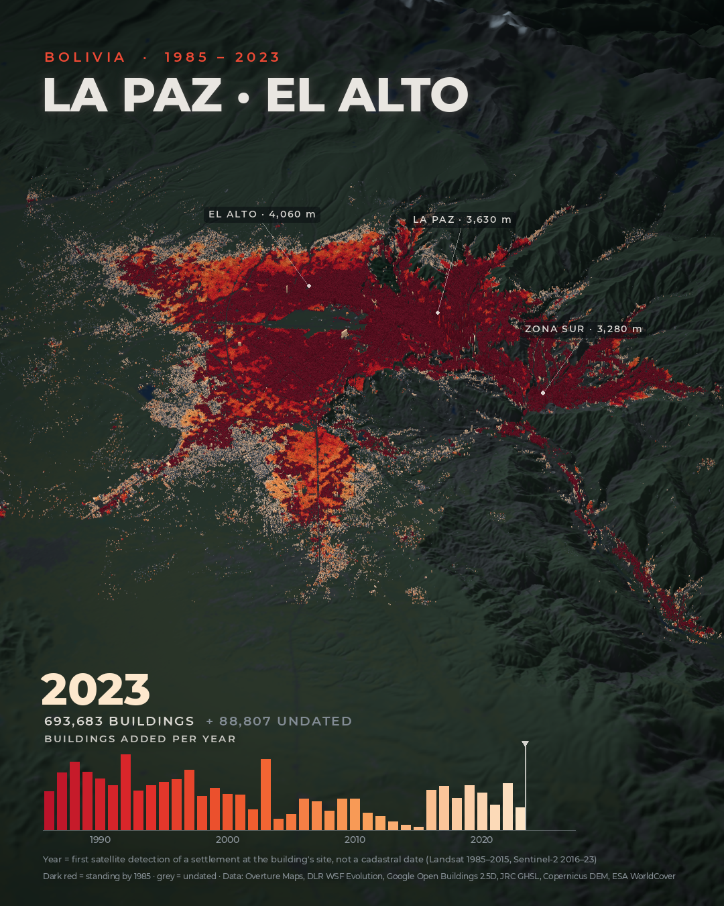

# La Paz · El Alto — a city growing, building by building

A 30-second vertical animation of how the La Paz – El Alto conurbation (Bolivia) grew
between **1985 and 2023**: 782,490 building footprints on a 3D landscape, each appearing in
the year satellites first saw a settlement at its location.



**Video:** [`out/la_paz_el_alto_growth.mp4`](out/la_paz_el_alto_growth.mp4) — 1080 × 1350 px
(4:5), 30 fps, H.264, no sound.

Inspired by [tulparmaps](https://www.instagram.com/tulparmaps/)' reel "Hong Kong buildings
construction year" (Alikhan Beisenbayev). The request that started this, and a better way
to phrase it, are in [`docs/PROMPT.md`](docs/PROMPT.md).

## What the picture says

| | buildings |
|---|---:|
| Standing by 1985 (dark red, the opening state) | 471,641 |
| Added 1986 – 2023 (red → orange → pale peach) | 222,042 |
| Undated (grey, revealed at the end) | 88,807 |
| **Footprints in total** | **782,490** |

La Paz fills its canyon early; after 1985 almost all growth happens on the plateau 400 m
above it — El Alto spreading north (Río Seco), south (Senkata, Ventilla) and west — and in
the side valleys of Zona Sur. The three labels carry terrain elevations sampled from the
DEM: the city drops about 800 m from El Alto to Zona Sur.

## Run it

```bash
python -m venv .venv && . .venv/bin/activate
pip install -r requirements.txt
```

```bash
python -m pipeline
```

```bash
python -m pipeline.validate
```

```bash
python -m render.animate
```

The pipeline downloads about 360 MB and takes roughly three minutes. Rendering takes about
ten minutes on four CPU cores; **no GPU is needed** (see [Why a software renderer](#why-a-software-renderer)).
`ffmpeg` must be on the path.

Useful while tuning: `python -m render.animate --year 2005` (one still),
`--still 12.5` (a still at 12.5 s), `--preview` (half-size draft in under a minute).
`python -m pytest` runs the unit tests of the dating rules and the rasteriser.

Hosts the pipeline talks to, for sandboxes with an allow-list:
`overturemaps-us-west-2.s3.amazonaws.com`, `download.geoservice.dlr.de`,
`jrc-ghsl.s3.amazonaws.com`, `storage.googleapis.com`,
`copernicus-dem-30m.s3.amazonaws.com`, `esa-worldcover.s3.eu-central-1.amazonaws.com`.

## Data

Everything is open data, fetched with plain HTTPS range requests — no accounts or keys.

| Used for | Dataset | Publisher | Resolution, period | Licence |
|---|---|---|---|---|
| Building footprints | [Overture Maps – buildings](https://docs.overturemaps.org/guides/buildings/), release 2026-10-21 (76 % Google Open Buildings, 19 % Microsoft, 4 % OpenStreetMap in this area) | Overture Maps Foundation | vector, c. 2023 | ODbL |
| Year, 1985 – 2015 | [World Settlement Footprint Evolution](https://geoservice.dlr.de/web/datasets/wsf_evo) | DLR (German Aerospace Center) | 30 m, yearly, Landsat 5/7 | CC BY 4.0 |
| Year, 2016 – 2023, and heights | [Open Buildings 2.5D Temporal](https://sites.research.google/gr/open-buildings/temporal/) | Google Research | 4 m, yearly, Sentinel-2 | CC BY 4.0 |
| Cross-check and fallback | [GHSL GHS-AGE R2025A, GHS-BUILT-S R2023A](https://human-settlement.emergency.copernicus.eu/) ([AWS mirror](https://registry.opendata.aws/ghs-age/)) | European Commission, JRC | 100 m, 5-year epochs 1975 – 2020 | CC BY 4.0 |
| Terrain | [Copernicus DEM GLO-30](https://registry.opendata.aws/copernicus-dem/) | ESA / Copernicus | 30 m | Copernicus DEM licence (free, attribution) |
| Land cover tint | [ESA WorldCover 2021 v200](https://esa-worldcover.org/) | ESA | 10 m | CC BY 4.0 |

**Looked for and not found:** an open cadastre with construction years. La Paz's municipal
cadastre is not published as open data, and OpenStreetMap carries next to no `start_date`
tags here. The municipality's "Mancha Urbana de La Paz (1956 – 2022)" map and IRD's atlas
plate "L'évolution de la tache urbaine 1976 – 2006" exist only as images in PDFs, not as
data. Georeferencing them would be the way to push the timeline back before 1985.

## How a building gets its year

There are no construction dates, so a building is dated by **when satellites first detected
a settlement at its location**. In plain words (code: [`pipeline/date_buildings.py`](pipeline/date_buildings.py)):

1. **DLR's yearly settlement raster is the backbone (1985 – 2015).** Its pixels are noisy —
   read one pixel per building and half of the colonial centre comes out as "1997". So a
   building takes the 35th percentile of the settled pixels within 90 m: *the year by
   which a third of its block was detected*. Whatever is detected in the first image year
   is "1985 or earlier", the stock the film opens with.
2. **Start-up correction.** The raster's first three years (1986 – 88) are inflated by thin
   early Landsat coverage. Where JRC's GHS-AGE independently says a cell was mostly built
   before 1985, such buildings join the 1985 stock (43,110 buildings).
3. **Google's yearly building-presence raster takes over (2016 – 2023)** for footprints
   outside DLR's settlement mask: a building is dated to the year its presence turns from
   absent to present and stays.
4. **JRC's 5-year epochs are the last resort** for buildings that stand in 2016 but that DLR
   never mapped; the year is drawn at random inside the epoch.
5. **Everything else stays undated** — 11 %, mostly small structures on the rural fringe —
   and is shown in grey at the end instead of being guessed.

| Dated by | buildings |
|---|---:|
| DLR WSF Evolution, own pixel | 611,453 |
| DLR WSF Evolution, adjacent pixel | 26,511 |
| Google Open Buildings 2.5D Temporal | 40,442 |
| JRC GHS-AGE epoch | 15,277 |
| undated | 88,807 |

**Heights** are the 80th percentile of Open Buildings 2.5D heights inside each footprint
(median of 2021 – 23), replaced by OpenStreetMap height or floor tags where they exist
(8,404 buildings). In the film they are exaggerated 9×; terrain 1.7×.

## Checks

`python -m pipeline.validate` reruns all of this.

**Known neighbourhoods.** The dating rules were chosen so that this table comes out right.
The test is coarse on purpose — was a district standing by 1985 or not — because the
periods are approximate and from general knowledge of the city. Corrections are welcome.

| Neighbourhood | Built up | Dated "by 1985" | Median year of the rest |
|---|---|---:|---:|
| Plaza Murillo (historic centre) | colonial | 95 % | 1990 |
| Sopocachi | early 20th c. | 89 % | 1988 |
| Miraflores | 1920s – 50s | 92 % | 1991 |
| Villa Fátima | 1950s – 70s | 98 % | 1991 |
| Calacoto (Zona Sur) | 1950s – 70s | 100 % | – |
| El Alto – Villa Dolores | 1940s – 60s | 100 % | 1987 |
| El Alto – 16 de Julio | 1950s – 70s | 98 % | 2016 |
| El Alto – Ciudad Satélite | 1960s – 70s | 100 % | – |
| El Alto – Villa Adela | from 1973 | 98 % | 1987 |
| El Alto – Río Seco | 1980s – 90s | 36 % | 1992 |
| Chasquipampa (Zona Sur) | 1980s – 2000s | 29 % | 1993 |
| El Alto – Senkata | 1990s – 2010s | 25 % | 1995 |
| El Alto – Ventilla | 2000s on | 6 % | 2001 |

**Do the two satellite records agree?** 98.9 % of the "1985 stock" lies in cells where the
JRC product, built independently, also shows built-up surface by 1990.

**Are the heights any good?** Against OpenStreetMap floor counts (× 3 m) the correlation is
0.83; for the 279 towers tagged with ten floors or more the means are 48.8 m (tags) and
49.9 m (satellite).

**A source left out.** JRC's GHSL also has a 1975 epoch, which could have moved the start
back ten years. It is not used for that: its 1980 and 1985 layers are interpolated between
the Landsat epochs of 1975 and 1990, so the years in between would be invented, and
GHS-AGE marks only 57 % of the historic centre, 39 % of Sopocachi and 49 % of Miraflores as
built before 1975 — districts that are generations older.

## What not to conclude from it

- **These are not construction dates.** A year says when a place was first seen as
  settled. A tower that replaced a 1950s house in 2015 still counts as "by 1985"; infill
  and rebuilding inside the old city are invisible.
- **The 1985 stock is an upper bound.** On the bare altiplano, Landsat struggles to tell
  compacted soil from low-density settlement, and both DLR and JRC lean towards dating
  such fringes too early. Growth after 1985 is, if anything, understated.
- **The dip of 2013 – 15 and the step in 2016 are instrument effects.** DLR's series
  under-detects its final years, and from 2016 a different sensor with a different rule
  takes over. Do not read a construction slump and boom into the histogram.
- **2017 – 2023 are noisy.** Applied to buildings that certainly predate 1985, the
  "new building" rule still fires for 8 %, which is why it is only used outside the old
  settlement mask. Expect ± 1 – 2 years.
- **Footprints are machine-made** (mostly Google's and Microsoft's detections from recent
  imagery): walled lots and sheds are in, some buildings are split or merged, demolished
  ones are missing. Footprints under 12 m² are dropped.
- **Viacha is left out** (a separate town in the south-west corner of the area).

## Make it yours

- [`render/config.py`](render/config.py) — title, your name (`AUTHOR`), camera move,
  timing, colours, labels, exaggeration.
- [`pipeline/config.py`](pipeline/config.py) — area, sources, exclusions. For another
  city change the bounding boxes, the UTM zone, the origin and the WSF tile; Open Buildings
  2.5D Temporal covers Africa, South and South-East Asia, Latin America and the Caribbean
  only, elsewhere steps 3 and the heights need another source.
- Thresholds of the dating rules sit at the top of
  [`pipeline/date_buildings.py`](pipeline/date_buildings.py).

## Why a software renderer

The scene is about eight million triangles. Headless Chromium's software WebGL needed
~10 s for a quarter of that, so the film is drawn by a small z-buffer rasteriser written in
NumPy and compiled with Numba ([`render/raster.py`](render/raster.py)): about one second
per frame at 4× supersampling on one core, identical output on any machine, no system
libraries.

## Layout

```
pipeline/   fetch_buildings · fetch_rasters · sample · date_buildings · build_scene · validate
render/     raster (rasteriser) · animate (timeline, post, encoding) · overlay (lettering) · config
tests/      unit tests for the dating rules and the rasteriser
docs/       PROMPT.md – the original request and a better version of it
data/       raw/ processed/ scene/ are created by the pipeline; only processed/summary.json is committed
out/        the video and its poster frame
assets/     Montserrat (SIL Open Font License)
```

## Credits

Building footprints © Overture Maps Foundation and contributors (OpenStreetMap, Google,
Microsoft), ODbL. World Settlement Footprint Evolution © DLR, CC BY 4.0. GHSL © European
Union, CC BY 4.0. Open Buildings 2.5D Temporal © Google, CC BY 4.0. Copernicus DEM
© DLR e.V. 2010 – 2014 and © Airbus Defence and Space GmbH 2014 – 2018, provided under
COPERNICUS by the European Union and ESA. ESA WorldCover 2021 © ESA WorldCover project,
contains modified Copernicus Sentinel data, CC BY 4.0. Typeface: Montserrat, SIL OFL 1.1.
