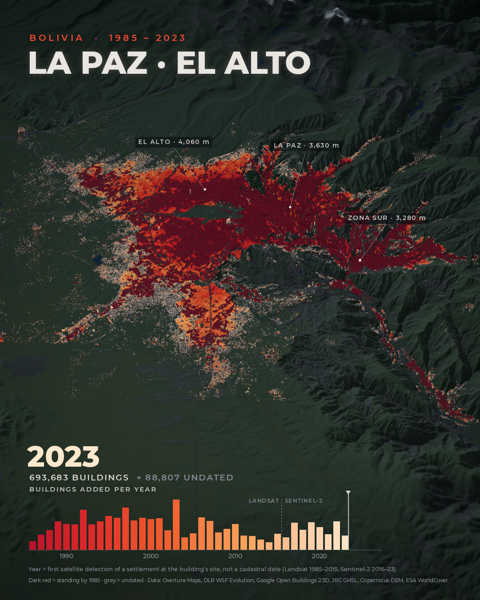

# La Paz · El Alto — a city growing, building by building

A 30-second vertical animation of how the La Paz – El Alto conurbation (Bolivia) grew
between **1985 and 2023**: 782,490 building footprints on a 3D landscape, each appearing in
the year satellites first saw a settlement at its location.



**Video:** [`out/la_paz_el_alto_growth.mp4`](out/la_paz_el_alto_growth.mp4) — 1080 × 1350 px
(4:5, Instagram feed), 30 fps, H.264, no sound. Full-screen Reels version:
[`out/la_paz_el_alto_growth_9x16.mp4`](out/la_paz_el_alto_growth_9x16.mp4) (1080 × 1920), with
the lettering kept clear of the Reels interface and the map running behind it.
A ready-to-paste caption is in [`docs/CAPTION.md`](docs/CAPTION.md).

Inspired by [tulparmaps](https://www.instagram.com/tulparmaps/)' reel "Hong Kong buildings
construction year" (Alikhan Beisenbayev). The request that started this, and a better way
to phrase it, are in [`docs/PROMPT.md`](docs/PROMPT.md).

## What the picture says

| | buildings |
|---|---:|
| Standing by 1985 (dark red, the opening state) | 458,451 |
| Added 1986 – 2023 (red → orange → pale peach) | 235,232 |
| Undated (grey, revealed at the end) | 88,807 |
| **Footprints in total** | **782,490** |

La Paz had filled its canyon by 1985. Of the buildings added since, 86 % stand on the
plateau above 3,900 m, about 400 m above the centre: El Alto spreading north (Río Seco),
south (Senkata, Ventilla) and west. La Paz's own basin and slopes took 12 %, Zona Sur 2 %.
The three labels carry terrain elevations sampled from the DEM: the city drops about 800 m
from El Alto to Zona Sur.

## Run it

Works on Windows, macOS and Linux. You need **Python 3.9 – 3.13** and **git** — a Mac
already has both (the built-in `python3` is fine). ffmpeg is optional: if it is not
installed, the copy that comes with the `imageio-ffmpeg` package is used. Plan for about
5 GB of free disk (frames are written to disk before encoding) and 8 GB of RAM for the
default four parallel jobs. No GPU, no accounts, no API keys.

**1. Install the tools** (once; open a new terminal afterwards)

| | |
|---|---|
| macOS | nothing to install. If macOS offers the "command line developer tools" the first time you type `git`, accept |
| Windows (PowerShell) | `winget install Python.Python.3.12`, then `winget install Git.Git` |
| Linux (Debian/Ubuntu) | `sudo apt install python3 python3-venv git` |

**2. Get the code** (or download the ZIP from the branch page on GitHub)

```bash
git clone -b claude/admiring-faraday-q4dq4t https://github.com/CarlitoVital/Fable_5.2_Test_10.11.2026.git
cd Fable_5.2_Test_10.11.2026
```

**3. Create the Python environment** (once)

macOS / Linux:

```bash
python3 -m venv .venv
source .venv/bin/activate
pip install --upgrade pip
pip install -r requirements.txt
```

Windows (PowerShell):

```powershell
py -3.12 -m venv .venv
.venv\Scripts\Activate.ps1
python -m pip install --upgrade pip
pip install -r requirements.txt
```

If PowerShell refuses to run `Activate.ps1`, allow local scripts once with
`Set-ExecutionPolicy -Scope CurrentUser RemoteSigned`. On an Apple Silicon Mac, the
prebuilt packages need macOS 14 or newer; on older systems `pip install` stops at
`rasterio`. In every new terminal, activate the
environment again (`source .venv/bin/activate` or `.venv\Scripts\Activate.ps1`) before
the commands below.

**4. Download and prepare the data** (once: about 360 MB and three minutes)

```bash
python -m pipeline
```

`python -m pipeline.validate` then prints the checks described under [Checks](#checks).

**5. Render**

```bash
python -m render.animate --year 2005
```

writes one still to `out/` to check the look; the very first run spends about half a
minute compiling the renderer.

```bash
python -m render.animate
```

renders the film: `out/la_paz_el_alto_growth.mp4` and `out/poster.png`, in about ten
minutes on four cores. `--format 9x16` makes the Reels version, `--preview` a half-size
draft in about a minute, `--still 12.5` a single frame at 12.5 s, and `--jobs 2` uses
less memory on smaller machines. Texts, colours, camera and your name live in
[`render/config.py`](render/config.py): edit, then render again — the data step does not
need to be repeated. `python -m pytest` runs the unit tests.

Hosts the pipeline talks to, for sandboxes with an allow-list:
`overturemaps-us-west-2.s3.amazonaws.com`, `download.geoservice.dlr.de`,
`jrc-ghsl.s3.amazonaws.com`, `storage.googleapis.com`,
`copernicus-dem-30m.s3.amazonaws.com`, `esa-worldcover.s3.eu-central-1.amazonaws.com`.

## Data

Everything is open data, fetched with plain HTTPS range requests — no accounts or keys.

| Used for | Dataset | Publisher | Resolution, period | Licence |
|---|---|---|---|---|
| Building footprints | [Overture Maps – buildings](https://docs.overturemaps.org/guides/buildings/), release 2026-10-21 (76 % Google Open Buildings, 19 % Microsoft, 4 % OpenStreetMap in this area) | Overture Maps Foundation | vector, c. 2023 | ODbL |
| Year, 1985 – 2015 | [World Settlement Footprint Evolution](https://geoservice.dlr.de/web/datasets/wsf_evo) | DLR (German Aerospace Center) | 30 m, yearly, Landsat 5/7 | CC BY 4.0 |
| Year, 2016 – 2023, and heights | [Open Buildings 2.5D Temporal](https://sites.research.google/gr/open-buildings/temporal/) | Google Research | 4 m, yearly, Sentinel-2 | CC BY 4.0 |
| Cross-check and fallback | [GHSL GHS-AGE R2025A, GHS-BUILT-S R2023A](https://human-settlement.emergency.copernicus.eu/) ([AWS mirror](https://registry.opendata.aws/ghs-age/)) | European Commission, JRC | 100 m, 5-year epochs 1975 – 2020 | CC BY 4.0 |
| Terrain | [Copernicus DEM GLO-30](https://registry.opendata.aws/copernicus-dem/) | ESA / Copernicus | 30 m | Copernicus DEM licence (free, attribution) |
| Land cover tint | [ESA WorldCover 2021 v200](https://esa-worldcover.org/) | ESA | 10 m | CC BY 4.0 |

**Looked for and not found:** an open cadastre with construction years. La Paz's municipal
cadastre is not published as open data, and OpenStreetMap carries next to no `start_date`
tags here. The municipality's "Mancha Urbana de La Paz (1956 – 2022)" map and IRD's atlas
plate "L'évolution de la tache urbaine 1976 – 2006" exist only as images in PDFs, not as
data. Georeferencing them would be the way to push the timeline back before 1985.

## How a building gets its year

There are no construction dates, so a building is dated by **when satellites first detected
a settlement at its location**. In plain words (code: [`pipeline/date_buildings.py`](pipeline/date_buildings.py)):

1. **DLR's yearly settlement raster is the backbone (1985 – 2015).** A building takes the
   year its own pixel was first detected as settled, checked against the pixels within
   90 m, because single pixels are noisy:
   - *old fabric* — if a third of the settled pixels around it date from 1985 or before,
     the building counts as "1985 or earlier". Read at face value, the raster puts half of
     the colonial centre in the 1990s;
   - *growth frontier* — if at least 30 % of its surroundings are still empty, its own
     year stands. The neighbours of a new house at the edge of the city are naturally
     older, and smoothing there would date the city's growth too early;
   - *inside built-up land* — its own year, held to the middle range (35th – 65th
     percentile) of the surrounding years, which removes isolated outliers both ways.

   Whatever is detected in the first image year is "1985 or earlier", the stock the film
   opens with. How this rule was chosen is under [Checks](#checks).
2. **Start-up correction.** The raster's first three years (1986 – 88) are inflated by thin
   early Landsat coverage. Where JRC's GHS-AGE independently says a cell was mostly built
   before 1985, such buildings join the 1985 stock (39,758 buildings).
3. **Google's yearly building-presence raster takes over (2016 – 2023)** for footprints
   outside DLR's settlement mask: a building is dated to the year its presence turns from
   absent to present and stays.
4. **JRC's 5-year epochs are the last resort** for buildings that stand in 2016 but that DLR
   never mapped; the year is drawn at random inside the epoch. For the last epoch
   (2015 – 2020) only 2015 or 2016 is possible: DLR's record ends in 2015 without the
   building, and Google's shows it in 2016.
5. **Everything else stays undated** — 11 %, mostly small structures on the rural fringe —
   and is shown in grey at the end instead of being guessed.

| Dated by | buildings |
|---|---:|
| DLR WSF Evolution, own pixel | 611,453 |
| DLR WSF Evolution, adjacent pixel | 26,511 |
| Google Open Buildings 2.5D Temporal | 40,442 |
| JRC GHS-AGE epoch | 15,277 |
| undated | 88,807 |

**Heights** are the 80th percentile of Open Buildings 2.5D heights inside each footprint
(median of 2021 – 23), replaced by OpenStreetMap height or floor tags where they exist
(8,404 buildings). In the film they are exaggerated 9×; terrain 1.7×.

## Checks

`python -m pipeline.validate` and `python -m pipeline.compare_rules` rerun all of this.

**Known neighbourhoods.** The dating rules were chosen so that this table comes out right.
The test is coarse on purpose — was a district standing by 1985 or not — because the
periods are approximate and from general knowledge of the city. Corrections are welcome.

| Neighbourhood | Built up | Dated "by 1985" | Median year of the rest |
|---|---|---:|---:|
| Plaza Murillo (historic centre) | colonial | 93 % | 1993 |
| Sopocachi | early 20th c. | 85 % | 1995 |
| Miraflores | 1920s – 50s | 89 % | 2001 |
| Villa Fátima | 1950s – 70s | 98 % | 1994 |
| Calacoto (Zona Sur) | 1950s – 70s | 100 % | – |
| El Alto – Villa Dolores | 1940s – 60s | 100 % | 1987 |
| El Alto – 16 de Julio | 1950s – 70s | 98 % | 2016 |
| El Alto – Ciudad Satélite | 1960s – 70s | 100 % | 1990 |
| El Alto – Villa Adela | from 1973 | 95 % | 1989 |
| El Alto – Río Seco | 1980s – 90s | 31 % | 1994 |
| Chasquipampa (Zona Sur) | 1980s – 2000s | 29 % | 1998 |
| El Alto – Senkata | 1990s – 2010s | 21 % | 1997 |
| El Alto – Ventilla | 2000s on | 7 % | 2003 |

**Choosing the rule.** Three ways of turning DLR's pixels into building years were tested
(`python -m pipeline.compare_rules`):

| Rule | Error vs JRC, 1990 | Error vs JRC, 2000 | Buildings per year 2011 – 16 | Speckle | Old districts |
|---|---:|---:|---|---:|---:|
| Neighbourhood 35th percentile (first version) | 0.296 | 0.253 | 2.7k 2.2k 1.3k 0.7k 3.6k 3.2k | 9.6 % | 13/13 |
| Own pixel, old fabric → 1985 | 0.253 | 0.212 | 5.2k 4.9k 3.6k 2.5k 4.6k 3.2k | 18.5 % | 13/13 |
| **Frontier-aware (in use)** | **0.258** | **0.219** | **3.6k 3.5k 2.6k 1.8k 4.1k 3.2k** | **12.5 %** | **13/13** |

*Error vs JRC*: per 100 m cell, the share of footprint area dated by that year against the
share of 2020's built-up surface JRC GHSL shows then (area-weighted RMSE; JRC observed
those years with Landsat, independently of DLR, though from similar imagery). *Speckle*:
share of post-1985 buildings more than five years away from the median year of their ten
nearest neighbours.
The first version was smooth but could only pull years earlier, so it emptied the end of
the Landsat record (it kept 10 of the 1,316 buildings whose pixels DLR dates to 2015). Using
each pixel as it is fixes that but turns districts into salt and pepper. The rule in use
keeps most of the gain at a small cost in speckle. The old-fabric share cannot go higher
than a third: at 40 % Sopocachi drops to 78 % "by 1985", at 45 % to 66 %.

**Do the two satellite records agree?** 99.0 % of the "1985 stock" lies in cells where the
JRC product, built independently, also shows built-up surface by 1990.

**Are the heights any good?** Against OpenStreetMap floor counts (× 3 m) the correlation is
0.83; for the 279 towers tagged with ten floors or more the means are 48.8 m (tags) and
49.9 m (satellite).

**A source left out.** JRC's GHSL also has a 1975 epoch, which could have moved the start
back ten years. It is not used for that: its 1980 and 1985 layers are interpolated between
the Landsat epochs of 1975 and 1990, so the years in between would be invented, and
GHS-AGE marks only 57 % of the historic centre, 39 % of Sopocachi and 49 % of Miraflores as
built before 1975 — districts that are generations older.

## What not to conclude from it

- **These are not construction dates.** A year says when a place was first seen as
  settled. A tower that replaced a 1950s house in 2015 still counts as "by 1985"; infill
  and rebuilding inside the old city are invisible.
- **The 1985 stock is an upper bound.** On the bare altiplano, Landsat struggles to tell
  compacted soil from low-density settlement, and both DLR and JRC lean towards dating
  such fringes too early. Growth after 1985 is, if anything, understated.
- **The low bars of 2011 – 14 are partly an instrument effect.** DLR's raw series itself
  thins out in its final years, and from 2016 a different satellite with a different rule
  takes over — the dotted line on the chart marks the switch. Bars on either side of it are
  not strictly comparable; do not read a slump or a boom into them.
- **2017 – 2023 are noisy.** Applied to buildings that certainly predate 1985, the
  "new building" rule still fires for 8 %, which is why it is only used outside the old
  settlement mask. Expect ± 1 – 2 years.
- **Footprints are machine-made** (mostly Google's and Microsoft's detections from recent
  imagery): walled lots and sheds are in, some buildings are split or merged, demolished
  ones are missing. Footprints under 12 m² are dropped.
- **Viacha is left out** (a separate town in the south-west corner of the area).

## Make it yours

- [`render/config.py`](render/config.py) — title, your name (`AUTHOR`), camera move,
  timing, colours, labels, exaggeration. Other frame shapes need no layout work
  (`--format 9x16`, or set `HEIGHT`): in a frame taller than 4:5 the lettering moves
  inwards to stay clear of Instagram's interface (`TALL_FRAME_MARGINS`), and the map
  gains the Cordillera Real above the city.
- [`pipeline/config.py`](pipeline/config.py) — area, sources, exclusions. For another
  city change the bounding boxes, the UTM zone, the origin and the WSF tile; Open Buildings
  2.5D Temporal covers Africa, South and South-East Asia, Latin America and the Caribbean
  only, elsewhere steps 3 and the heights need another source.
- Thresholds of the dating rules sit at the top of
  [`pipeline/date_buildings.py`](pipeline/date_buildings.py).

## Why a software renderer

The scene is about eight million triangles. Headless Chromium's software WebGL needed
~10 s for a quarter of that, so the film is drawn by a small z-buffer rasteriser written in
NumPy and compiled with Numba ([`render/raster.py`](render/raster.py)): about one second
per frame at 4× supersampling on one core, identical output on any machine, no system
libraries.

## Layout

```
pipeline/   fetch_buildings · fetch_rasters · sample · date_buildings · build_scene · validate · compare_rules
render/     raster (rasteriser) · animate (timeline, post, encoding) · overlay (lettering) · config
tests/      unit tests for the dating rules and the rasteriser
docs/       PROMPT.md – the original request and a better version of it; CAPTION.md – post text
data/       raw/ processed/ scene/ are created by the pipeline; only processed/summary.json is committed
out/        the videos (4:5 and 9:16) and their poster frames
assets/     Montserrat (SIL Open Font License)
```

## Credits

Building footprints © Overture Maps Foundation and contributors (OpenStreetMap, Google,
Microsoft), ODbL. World Settlement Footprint Evolution © DLR, CC BY 4.0. GHSL © European
Union, CC BY 4.0. Open Buildings 2.5D Temporal © Google, CC BY 4.0. Copernicus DEM
© DLR e.V. 2010 – 2014 and © Airbus Defence and Space GmbH 2014 – 2018, provided under
COPERNICUS by the European Union and ESA. ESA WorldCover 2021 © ESA WorldCover project,
contains modified Copernicus Sentinel data, CC BY 4.0. Typeface: Montserrat, SIL OFL 1.1.
